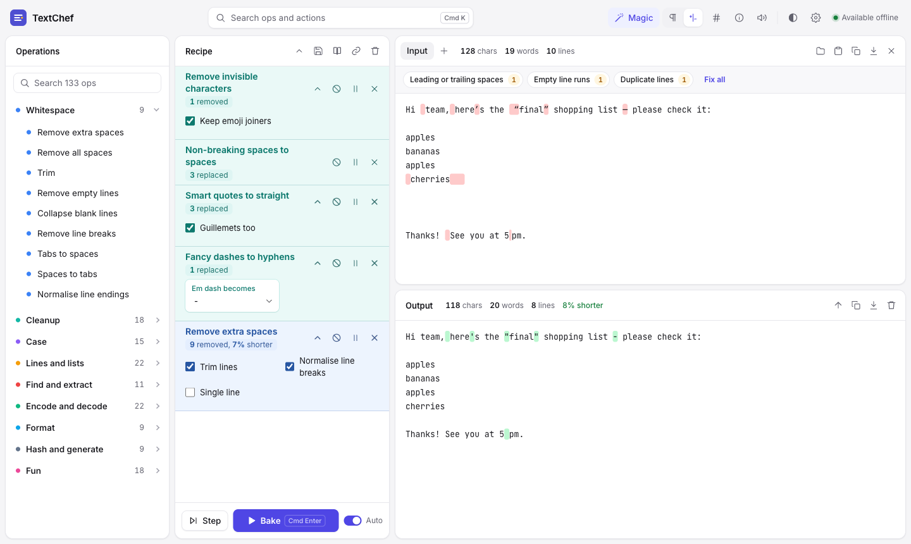
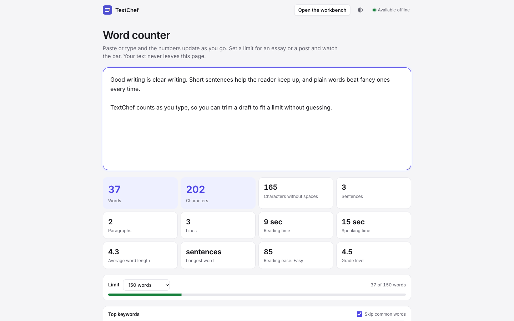

<p align="center">
  
</p>

<h1 align="center">TextChef</h1>

<p align="center"><b>Clean, convert and count text. Right in your browser, even offline.</b></p>

<p align="center">
  <a href="https://github.com/DakshRocks21/TextChef/actions/workflows/ci.yml"></a>
  
  
  
</p>

<p align="center">
  <a href="https://dakshrocks21.github.io/TextChef/"><b>Open TextChef</b></a>
  &nbsp;&nbsp;|&nbsp;&nbsp;
  <a href="https://dakshrocks21.github.io/TextChef/word-counter/">Word counter</a>
  &nbsp;&nbsp;|&nbsp;&nbsp;
  <a href="https://github.com/DakshRocks21/TextChef/issues/new">Report a problem</a>
</p>

<picture>
  <source media="(prefers-color-scheme: dark)" srcset="docs/screenshot-dark.png">
  
</picture>

## What is TextChef?

TextChef fixes messy text. Paste something in and it shows you what is wrong with it, like double spaces, curly quotes, hidden characters or repeated lines. One click fixes it.

It is inspired by [CyberChef](https://github.com/gchq/CyberChef), the "Cyber Swiss Army Knife", but made for everyday text instead of security work. You never need to know what an "operation" is to use it, and if you do want the power tools, all 133 of them are there.

## What can I do with it?

| You have... | TextChef... |
| --- | --- |
| Text pasted from Word, an email or a website, full of odd quotes, double spaces and invisible characters | spots every problem and fixes it all with **Fix all** |
| A list with repeats in it | removes duplicates and sorts it with the **Dedupe and sort list** starter |
| An essay or post with a word limit | counts words, characters, reading time and readability as you type, with a bar that turns red when you go over |
| A blog post title | turns it into a clean URL slug like `my-blog-post-title` |
| Text in the wrong case | switches between UPPER, lower, Title Case, Sentence case, camelCase, snake_case and more |
| Something that looks like gibberish, such as `SGVsbG8=` or `%20` | works out what it is when you press **Magic**, then decodes it |
| A huge log or data file | opens it anyway. 100 MB is fine. |

## How do I use it?

1. **Paste your text**, or drop a file anywhere on the page.
2. **Click a yellow chip** above the text to fix a problem, or pick a starter like *Clean pasted text*.
3. **Copy or download** the result from the output box.

That's it. Want more? Search for any operation with <kbd>Ctrl</kbd> <kbd>K</kbd>, chain several into a recipe, and save it or share it as a link.

## Is my text private?

Yes. Everything happens on your own device. Your text is never uploaded, there are no accounts, and there are no trackers. Shared links include only the recipe, never your text, unless you tick "Include input" yourself.

## Does it work offline?

Yes. After your first visit TextChef keeps working without an internet connection, and you can install it like an app from your browser's menu.

<p align="center">
  
</p>

---

## For developers

The rest of this page is technical.

- **No toolchain.** Vanilla JS ES modules. No frameworks, no npm dependencies, no CDNs, no analytics. `node build.js` is the whole build.
- **Small and lazy.** The core shell is about 46 KB gzipped, plus 78 KB of self-hosted fonts (Inter and JetBrains Mono from Google Fonts). The 133 operations live in 9 category modules that load on first use and are precached for offline.
- **Built for big files.** A 100 MB file opens in under half a second. Recipes bake in a worker while the page stays responsive. See [Big files](#big-files).
- **Offline-first.** A content-hashed service worker serves every page and asset cache-first. After the first load the app makes zero network requests.
- **Tested.** Every operation is tested against empty input, CRLF, emoji, NBSP, zero-width characters and a 1 MB input.

### Contents

- [Quick start](#quick-start)
- [Tests and benchmarks](#tests-and-benchmarks)
- [How it works](#how-it-works)
- [Big files](#big-files)
- [Adding an operation](#adding-an-operation)
- [Styles](#styles)
- [Deploy](#deploy)
- [Offline, updates and recovery](#offline-updates-and-recovery)
- [Keyboard](#keyboard)
- [Limits](#limits)

### Quick start

Needs Node 20 or newer. There is nothing to install.

```bash
git clone https://github.com/DakshRocks21/TextChef.git
```

```bash
cd TextChef && node build.js && node serve.js
```

Then open http://localhost:8080. Set `PORT` to use another port. `SITE_URL` sets the domain used for canonical URLs, Open Graph tags and the sitemap:

```bash
SITE_URL=https://your-domain.example/ node build.js
```

### Tests and benchmarks

```bash
node --test
```

- `test/all-ops.test.js` runs every operation in the registry against empty input, CRLF, Unicode and emoji (ZWJ sequences and flags), NBSP, zero-width characters and a 1 MB input. Each must return a string or throw an `OpError`, keep surrogate pairs whole and finish 1 MB in under 4 s. New operations are covered automatically.
- `test/<category>.test.js` checks expected outputs for every operation and option.
- `test/core.test.js` covers the recipe runner, URL hash encoding, stats, chips and diff.
- `test/copy.test.js` enforces the copy rules: no middle dot and no em dash anywhere in the source, the build or this README.

```bash
node --max-old-space-size=8192 bench/ops.js 20
```

This prints every operation's time on a 20 MB input, slowest first.

### How it works

```
build.js              zero-dependency build, writes dist/
serve.js              tiny static server for dist/
bench/ops.js          operation throughput benchmark
src/
  index.html          app template, also used by every SEO entry page
  word-counter.html   the standalone word counter page
  reset.html          manual recovery page
  pages.js            SEO entry pages: slug, title, description, intro, preloaded recipe
  sw.js               service worker template
  partials/           head (with the self-heal boot guard), icon sprite, word counter markup
  styles/app.css      Tailwind source for assets/app.css
  assets/
    app.css           compiled styles (committed)
    fonts/            self-hosted Inter and JetBrains Mono, latin subset
    js/               page: app, registry, recipe, stats, chips, diff, mirror, store, engine
                      worker: worker, source
    ops/              one module per category, lazy-loaded
test/
```

- `build.js` imports every op module in Node and writes `js/ops-index.js`. That file holds the metadata the UI needs to list, search and configure operations before their modules load.
- All assets go under `dist/assets/<version>/`, where the version is a hash of the whole source.
- The service worker precaches every page and asset under that one version.
- The build also writes 31 SEO entry pages (`/remove-extra-spaces/`, `/json-formatter/` and so on). Each one is the full app with a recipe preloaded, plus `sitemap.xml`, `robots.txt` and the hosting header files.

### Big files

Text that would slow the page down never lives on the page.

| Input size | Where it lives | Where it bakes |
| --- | --- | --- |
| Up to 256 KB | The page, editable | The page, as you type |
| Up to 2 MB | The page, editable | The engine worker |
| Over 2 MB, from a file, a drop or a paste | A `Blob` handle plus a 500,000 character preview | The engine worker, which reads and caches the text |

- `src/assets/js/worker.js` reads the Blob, streaming it with progress above 16 MB. It caches the text, runs the recipe, and sends back a preview plus stats.
- Download, and saving back to a file, get a `Blob` straight from the worker, so 100 MB never passes through the page as a string.
- Copy fetches the full output from the worker, and refuses above 50 million characters.
- Input stats, output stats and the word counter are computed in the worker. Above 2 MB they use a single-pass character scanner instead of `Intl.Segmenter`.
- Cancel terminates the worker. The next bake starts a fresh one and re-reads the Blob.
- Binary files are rejected and UTF-16 files with a BOM are decoded.

Measured in Chromium on an M-series Mac with a 103 MB file:

| | |
| --- | --- |
| Open the file | 0.4 s |
| Bake *Remove extra spaces* then *Upper case* | 1 s |
| Longest main-thread block | 36 ms |
| Page heap | 23 MB |
| Full word counter stats | 3.6 s, in the worker |

**Documents are next.** `src/assets/js/source.js` is the one place where a file becomes text, and it runs in the worker. To support PDF, DOCX and other formats, register an extractor with `addExtractor({ match(file), extract(file, onProgress) })` that resolves to text. Everything downstream (preview, stats, recipes, download) already works on whatever text it returns.

### Adding an operation

Pick the category file in `src/assets/ops/` and add an object to its default export. An operation takes under 15 lines:

```js
{
  id: 'remove-vowels',
  name: 'Remove vowels',
  keywords: 'strip aeiou letters',
  options: [{ id: 'y', label: 'Count y as a vowel', type: 'bool', default: false }],
  run: (text, o) => text.replace(o.y ? /[aeiouy]/gi : /[aeiou]/gi, ''),
},
```

- `run(text, opts)` is a pure function and may be async. `opts` has every default filled in.
- Return a string, or `{ text, note }` to show a short note under the step, for example `'12 removed'`.
- For bad input, throw an error whose `name` is `'OpError'`. There is a `fail()` helper at the top of `encode.js`. The message is shown to the user.
- Op modules import nothing, so the same file runs in Node, the page and the worker. No DOM.
- Option types are `bool`, `select` (with `choices: [[value, label]]`), `number`, `range` and `text`.
- Add `magic: true` and `detect(text)` (a 0 to 1 confidence) to have Magic suggest the operation.
- Write non-ASCII characters as `\uXXXX` escapes.

Then run `node --test`. The generic harness picks up the new operation straight away. A new category is a new file that exports `category = { id, name, color, order }` and a default array of operations. A new SEO entry page is one entry in `PAGES` in `src/pages.js`. The build fails if a page names an operation that does not exist.

### Styles

- `src/styles/app.css` is the Tailwind CSS v4 source: theme tokens, base styles and components.
- `src/assets/app.css` is the compiled output. It is committed, so `node build.js` never needs Tailwind.
- To change styles, put the [Tailwind standalone CLI](https://github.com/tailwindlabs/tailwindcss/releases) at `tools/tailwindcss` (it is git-ignored). While it is there, `node build.js` recompiles the CSS first. Still no npm.
- Fonts are [Inter](https://github.com/rsms/inter) and [JetBrains Mono](https://github.com/JetBrains/JetBrainsMono), latin subsets from Google Fonts, under the SIL Open Font License 1.1. Their license texts ship next to them in `src/assets/fonts/`.
- Colours are CSS variables, mapped into Tailwind with `@theme inline`. That's why the light, dark and follow-system theme toggle works without `dark:` classes.

### Deploy

Every host serves `dist/` as plain static files. The build writes `_headers` and `netlify.toml`. They make HTML, `sw.js` and the manifest `no-cache`, and cache `/assets/*` for a year. That is safe because asset paths change with every build.

| Host | Setup |
| --- | --- |
| GitHub Pages | `.github/workflows/pages.yml` builds and deploys on every push to `main`. In the repo settings, set Pages to deploy from GitHub Actions. |
| Cloudflare Pages | Build command `node build.js`, output directory `dist`, environment variable `SITE_URL`. |
| Netlify | `netlify.toml` already sets the build. Add `SITE_URL` as an environment variable. |

All paths are relative, so project sites under `/repo-name/` work.

### Offline, updates and recovery

- **Normal use.** The service worker serves everything cache-first from one versioned cache. Offline works with a normal reload, a new tab or the installed app. A cache-bypassing hard reload skips service workers in every browser by design.
- **Updates.** When a new build ships, the browser fetches the new `sw.js` in the background. A toast says *Update ready*, and the new version takes over only when you click Reload.
- **Recovery.** If the app fails to boot while online, an inline guard in `<head>` unregisters service workers, clears caches and reloads, once per session. `/reset/` does the same by hand.
- **Storage.** Settings, favourites and saved recipes live under one versioned localStorage key, and unknown versions are ignored. Remembering the last input is off by default and is stored under its own keys.

### Keyboard

| Keys | Action |
| --- | --- |
| <kbd>Ctrl</kbd> <kbd>K</kbd> | Search operations, starters and actions |
| <kbd>Ctrl</kbd> <kbd>Enter</kbd> | Bake |
| <kbd>Ctrl</kbd> <kbd>Shift</kbd> <kbd>C</kbd> | Copy output |
| <kbd>Esc</kbd> | Close panels and popovers |
| <kbd>Enter</kbd> on an operation | Add it to the recipe |
| <kbd>Alt</kbd> <kbd>Up</kbd> / <kbd>Down</kbd> on a step | Move the step |
| Arrow keys on a pane divider | Resize panes |

On a Mac, use <kbd>Cmd</kbd> instead of <kbd>Ctrl</kbd>.

### Limits

- Highlights (invisibles, diff and regex matches) switch off above 200,000 characters.
- Outputs over 500,000 characters show a preview. Download and save always use the full text.
- About 500 MB of text per input, which is close to V8's string size limit.
- Read aloud uses your system's voices, and works offline when local voices are installed.
